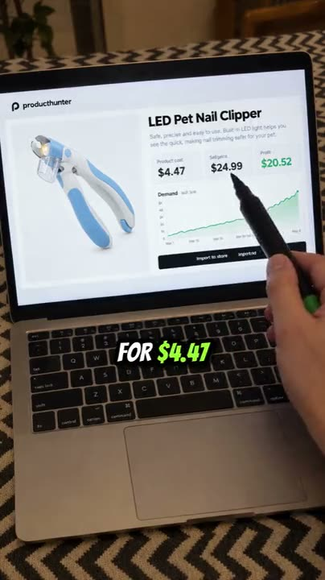
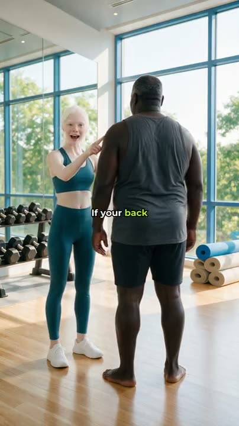
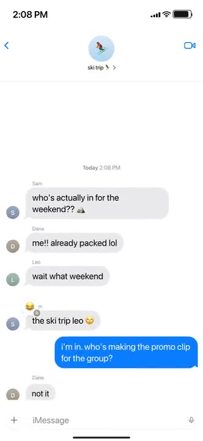
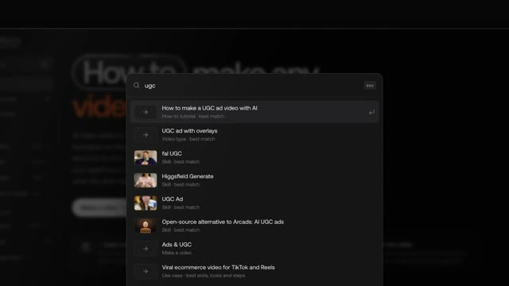
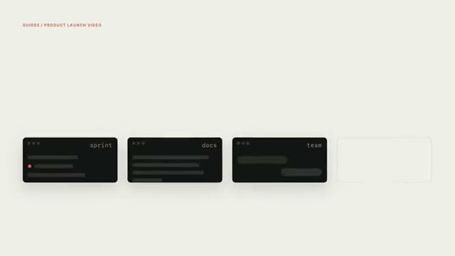
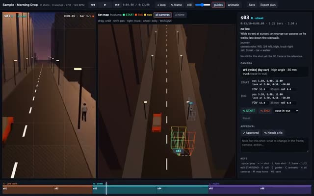
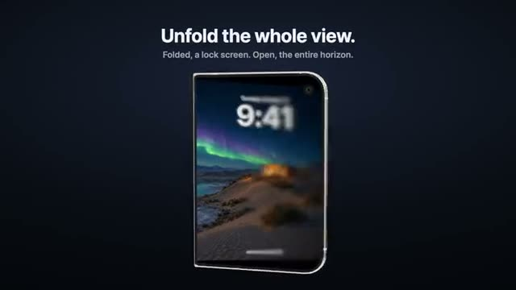
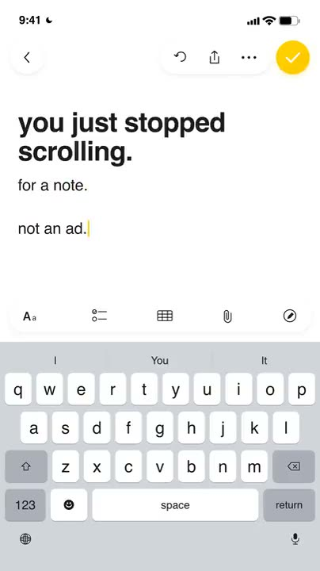

# Awesome AI video agents: skills, MCP servers and tools for making video with Claude Code, Codex and Grok

Tell your coding agent what video you need ("a UGC ad for my serum", "cut this podcast into Shorts with captions", "a lyric video for my song") and it finds the skill that makes it, shows you the options with example videos, and runs the pipeline: AI shots on Seedance 2.5, Kling 4 or Veo 3.1, voice on ElevenLabs, captions and cuts with FFmpeg, Remotion or HyperFrames, out to a 9:16 or 16:9 MP4. This list is the open index behind [varg.ai/how-to](https://varg.ai/how-to): every card has an install command for Claude Code, Codex, Cursor, Gemini CLI and OpenClaw, its source, its license and an example.

<!-- sync:counts:start -->
**646 cards** from **214 publishers** (523 live, 33 wanted) and **39 step-by-step tutorials**, synced from [varg.ai/how-to](https://varg.ai/how-to) on 2026-10-28.
<!-- sync:counts:end -->

> **For AI agents:** one search, no key, any language: `curl -s "https://varg.ai/how-to/api/search?q=<what the person wants>"` returns the best step-by-step tutorial and the top skills with install commands, as markdown. Same thing as MCP tools: `claude mcp add --transport http varg-how-to https://api.varg.ai/v2/skills/mcp`. Index: <https://varg.ai/how-to/llms.txt>. Then read [AGENTS.md](AGENTS.md).

## Get started in 60 seconds

**Claude Code** (the finder skill, the generation skill and the varg MCP server in one plugin):

```bash
claude plugin marketplace add vargHQ/skills && claude plugin install varg@varg
```

**Codex, Cursor, Gemini CLI, Windsurf, OpenCode** (any agent that reads SKILL.md):

```bash
npx skills add vargHQ/skills --skill how-to-make-ai-video    # finds the right skill for any video request
npx skills add vargHQ/skills --skill varg-ai                 # generates video, images, voice and music
```

**Claude.ai, Claude Desktop, ChatGPT, VS Code** (MCP, sign in with OAuth, no key to paste): add the server `https://mcp.varg.ai/mcp` as a custom connector, or in a config file:

```json
{ "mcpServers": { "varg": { "url": "https://mcp.varg.ai/mcp" } } }
```

Then say what you want:

```
Make a 15-second UGC ad for this product: <photo URL>. Show me 3 hook options first.
```

The agent searches this catalog, puts 2–4 choices in front of you with example clips, quotes the price in credits (1 credit = $0.01, free plan, no card) and generates only after you pick. Per-client setup, with screenshots: [docs.varg.ai/mcp-server](https://docs.varg.ai/mcp-server).

## Examples: what agents make with these skills

Every clip below was made by an agent with a skill from this list. Click a frame to watch.

| | | |
|---|---|---|
| [](https://s3.varg.ai/how-to/previews/356b46885295/varg-dropship-reel.mp4)<br>**Dropshipping guide reel** from one product photo: hook, price math on a laptop, word captions. [skill](skills/workflow/varg-dropship-reel.md) · [tutorial](how-to/make-viral-ecommerce-videos.md) | [](https://s3.varg.ai/how-to/previews/e3b1590f42f1/varg-product-hook.mp4)<br>**Viral product hook**: the first 3 seconds, remade with your product as phone or security-cam footage on Seedance 2.5. [skill](skills/workflow/varg-product-hook.md) | [](https://s3.varg.ai/how-to/previews/100daa58d70d/varg-podcast-video.mp4)<br>**Podcast clip from a script**: one studio set, host and guest, locked angles. [skill](skills/workflow/varg-podcast-video.md) |
| [](https://s3.varg.ai/how-to/previews/fd12064dae3c/varg-consistent-characters.mp4)<br>**Consistent characters**: the same actors, outfits and location in every cut of a micro-drama ad. [skill](skills/workflow/varg-consistent-characters.md) · [tutorial](how-to/keep-a-character-consistent-in-ai-video.md) | [](https://s3.varg.ai/how-to/previews/2fc5d178d91b/varg-imessage-video.mp4)<br>**iMessage story video** from a JSON script: iOS chrome, typing, sounds, a cliffhanger. [skill](skills/workflow/varg-imessage-video.md) · [tutorial](how-to/make-a-text-message-story-video.md) | [](https://s3.varg.ai/files/60c50c05-1e93-46b9-ae75-47be786b4ff0/file_12540de8467b.mp4)<br>**Launch film in Remotion** from eight markdown files, directed stage by stage by Claude Opus 5.5. [card](https://varg.ai/how-to/skills/opus-5-5-motion-studio-harness.md) · [template](https://github.com/vargHQ/code2video-templates/tree/master/motion-studio-launch-film) |
| [](https://s3.varg.ai/how-to/previews/400daa5dc577/hyperframes.mp4)<br>**HTML to video with HyperFrames**: launch films, explainers and charts rendered deterministically. [skill](skills/guide/hyperframes.md) · [tutorial](how-to/make-an-explainer-video.md) | [](https://s3.varg.ai/how-to/previews/3953d368f7d3/remotion-captions.mp4)<br>**Animated captions with Remotion**: transcribe, then burn in word-timed TikTok captions. [skill](skills/effect/remotion-captions.md) · [tutorial](how-to/add-animated-captions-to-a-video.md) | [](https://s3.varg.ai/how-to/previews/2f5f2d60dd84/varg-previz.mp4)<br>**Previz before you pay**: story, anchor sheets, a three.js grey-box with cameras, then Seedance shots. [skill](skills/workflow/varg-previz.md) · [tutorial](how-to/make-an-ai-short-film.md) |
| [](https://s3.varg.ai/how-to/previews/b1adcaedb8e5/iphone-duo-fold.mp4)<br>**App demo on a foldable phone**: your screens unfold in 3D with progressive blur, a code template. [skill](skills/effect/iphone-duo-fold.md) · [tutorial](how-to/make-an-app-demo-video.md) | [](https://s3.varg.ai/how-to/previews/b6912b876f91/craft-camera-moves.mp4)<br>**Camera moves as prompts**: 47 moves with direction, speed and end frame, for six model families. [skill](skills/prompt/craft-camera-moves.md) | [](https://s3.varg.ai/how-to/previews/d146add52283/gooseworks-apple-notes-ads.mp4)<br>**Apple Notes typing ad** from a reference ad or a ready style, made in chat. [skill](skills/workflow/gooseworks-apple-notes-ads.md) · [tutorial](how-to/make-a-notes-app-video-ad.md) |

More finished examples with prompts and prices: [ecommerce AI video skills](https://github.com/vargHQ/ecommerce-ai-video-skills) (ASMR unboxing, singing mascot, try-on, 20 ad variants, localization, compliance check) and [how to make AI videos for dropshipping](https://github.com/vargHQ/how-to-make-ai-videos-for-dropshipping) (5 reels, second by second, with costs).

## How to make any video with AI: step-by-step tutorials

Each tutorial names the best skill, the alternatives, the choices to show the person first (with example clips) and the numbered steps. Short mirrors here, full pages on varg.ai/how-to (add `.md` to any page for the markdown twin).

<!-- sync:how-to:start -->
- [How to make a UGC ad video with AI](how-to/make-a-ugc-ad-video.md) — A creator-style ad: a person talks to camera about your product, with b-roll, captions and an end card.
- [How to make video ad variants for testing with AI](how-to/make-video-ad-variants-for-testing.md) — Ten or more short video ads from one brief, each with a different hook or format, for Meta/TikTok creative testing.
- [How to turn a product photo into a video with AI](how-to/turn-a-product-photo-into-a-video.md) — A product shot turned into a short promo: orbit, push-in, exploded view or bullet time, with music.
- [How to make viral ecommerce videos for TikTok and Reels](how-to/make-viral-ecommerce-videos.md) — Product videos that sell on TikTok, TikTok Shop, Instagram Reels and Meta ads: the angle, the hook, the format, the person on camera, the rules and the variants.
- [How to make a TikTok Shop video with AI](how-to/make-a-tiktok-shop-video.md) — A shoppable or affiliate TikTok Shop video that sells and stays compliant: product in frame from the first second, a real presenter, one number, a cart CTA.
- [How to edit a product video for TikTok and Reels with AI](how-to/edit-a-product-video-for-tiktok.md) — Raw product footage (a creator clip, an unboxing, last month's winning ad) recut into a 9:16 ad: hook at second 0, no dead air, captions, one CTA, one file per hook.
- [How to cut a podcast into short video clips with AI](how-to/cut-a-podcast-into-short-video-clips.md) — Find the best moments in a long video, cut them, reframe to 9:16 and burn captions.
- [How to add animated captions to a video with AI](how-to/add-animated-captions-to-a-video.md) — TikTok-style subtitles burned into an existing video: word highlight, pop words, or designed editorial captions.
- [How to make a talking avatar video with AI](how-to/make-a-talking-avatar-video.md) — A person (from a headshot, or generated) speaks your script to camera with lip-sync, in any language.
- [How to translate and dub a video with AI](how-to/translate-and-dub-a-video.md) — Your video in another language with your own voice, optionally lip-synced and subtitled.
- [How to make a faceless YouTube video with AI](how-to/make-a-faceless-youtube-video.md) — A narrated short or long video with no presenter: script, voiceover, visuals, captions, music.
- [How to make a text message story video with AI](how-to/make-a-text-message-story-video.md) — A viral iMessage-style chat drama: bubbles appear with typing, sounds and a cliffhanger.
- [How to make a Notes app video ad with AI](how-to/make-a-notes-app-video-ad.md) — A note types itself in a phone notes app, reads like a confession, and turns into an ad.
- [How to make a SaaS launch video with AI](how-to/make-a-saas-launch-video.md) — A polished launch film for an app or website: UI cards, device mockups, kinetic type, music.
- [How to turn release notes into a changelog video with AI](how-to/turn-release-notes-into-a-changelog-video.md) — Release notes, a PR or a GitHub repo turned into a short video for X or LinkedIn.
- [How to make an explainer video with AI](how-to/make-an-explainer-video.md) — A narrated explainer about a product, a topic or a document, with motion graphics or AI visuals.
- [How to make an AI music video](how-to/make-an-ai-music-video.md) — A music video for your song: concept, a consistent lead character, shots cut on the beat, lip-sync on vocals.
- [How to make a lyric video with AI](how-to/make-a-lyric-video.md) — Lyrics synced to the song: the sung line big and highlighted, karaoke-style, over art or a shader.
- [How to turn photos into a slideshow video with AI](how-to/turn-photos-into-a-slideshow-video.md) — Your photos cut to music, with motion, transitions on the beat and titles.
- [How to make an AI short film](how-to/make-an-ai-short-film.md) — A multi-shot story with consistent characters: script, storyboard, previz, shots, edit.
- [How to keep a character consistent in AI video](how-to/keep-a-character-consistent-in-ai-video.md) — One mascot, trainer or actor that looks identical across many images and clips.
- [How to make an AI influencer video](how-to/make-an-ai-influencer-video.md) — A recurring AI character with one look and one format, posting as a creator or a brand face.
- [How to make exercise demo video loops with AI](how-to/make-exercise-demo-video-loops.md) — Looping exercise demos for a fitness app: one trainer, many exercises, clean background.
- [How to make a logo animation with AI](how-to/make-a-logo-animation.md) — Your logo animated into a short intro or outro: 3D chrome, liquid, shader, glitch or clean motion.
- [How to make an animated chart video with AI](how-to/make-an-animated-chart-video.md) — Numbers from a CSV or a report as an animated chart: bar race, line, hero number.
- [How to make YouTube video thumbnails with AI](how-to/make-youtube-video-thumbnails.md) — High-CTR thumbnails and vertical covers, in a few options to choose from.
- [How to make AI product photos and listing images](how-to/make-ai-product-photos.md) — Marketplace listing images, lifestyle shots and packshots from one product photo.
- [How to edit your own video footage with AI](how-to/edit-your-own-video-footage.md) — Cut silences and flubs, reframe 16:9 to 9:16, add captions and b-roll to footage you shot.
- [How to remake a reference video with AI](how-to/remake-a-reference-video.md) — Take a reel or ad you like, break it down shot by shot, and remake the format for your brand.
- [How to add voiceover and music to a video with AI](how-to/add-voiceover-and-music-to-a-video.md) — A professional voiceover and a fitting music bed added to your video or screen recording.
- [How to animate a photo into a video with AI](how-to/animate-a-photo-into-a-video.md) — A still photo brought to life: a subtle smile, blink, camera move or full scene motion.
- [How to make trending AI video formats](how-to/make-trending-ai-video-formats.md) — What's going viral now — formats you can make for your brand today, with the skill for each.
- [How to swap your character into a video with AI](how-to/swap-your-character-into-a-video.md) — Your character (or person) performs the exact motion of a trending video: dance, gesture, walk, ad performance — motion transfer.
- [How to make AI b-roll for your video](how-to/make-ai-b-roll-for-your-video.md) — Cutaway footage for every mention in a voiceover or interview: generated clips, collage or stock-style shots, cut in on time.
- [How to make TikTok photo carousels with AI](how-to/make-tiktok-photo-carousels.md) — Swipeable photo slideshows with hook text — the format app founders use for organic growth.
- [How to make an app demo video with AI](how-to/make-an-app-demo-video.md) — A polished demo of your app: device mockups, real screens, captions, music — for the App Store, ads or a landing page.
- [How to make a property listing video with AI](how-to/make-a-property-listing-video.md) — A listing reel from property photos: gentle camera motion through rooms, captions with price and features, music.
- [How to change something inside a video with AI](how-to/change-something-inside-a-video.md) — Swap a product, restyle a scene, change lighting or the look of an existing clip while keeping the motion.
- [How to make personalized videos at scale with AI](how-to/make-personalized-videos-at-scale.md) — One template, many versions: each lead's name, company and website in the video, optionally in a cloned voice.
<!-- sync:how-to:end -->

## Skills by shelf

The same cards cut by what they are. Full index with every card by category: [skills/README.md](skills/README.md).

<!-- sync:shelves:start -->
| Shelf | Cards | What it holds | For example |
|---|---:|---|---|
| [Workflows](skills/README.md#workflow) | 94 | End-to-end pipelines: brief in, finished video out. | [Turn a product into a dropshipping guide reel](skills/workflow/varg-dropship-reel.md), [Turn product photos into a viral product hook](skills/workflow/varg-product-hook.md), [HyperFrames Figma](skills/workflow/hyperframes-figma.md) |
| [Prompts](skills/README.md#prompt) | 33 | Prompt packs for video and image models: camera moves, shot sizes, lighting, characters, hooks. | [fal Cinematography](skills/prompt/fal-cinematography.md), [fal Prompting](skills/prompt/fal-prompting.md), [Replicate Prompt Videos](skills/prompt/replicate-prompt-videos.md) |
| [Effects](skills/README.md#effect) | 233 | Transitions, captions, titles, device mockups, shaders and every named edit, with the code that makes it. | [iPhone Duo Fold](skills/effect/iphone-duo-fold.md), [Hard Cut](skills/effect/hard-cut.md), [Jump Cut](skills/effect/jump-cut.md) |
| [Styles](skills/README.md#style) | 18 | Looks, LUTs, fonts and art directions a model or a render can follow. | [fal Game Dev](skills/style/fal-gamedev.md), [Brand Guidelines](skills/style/anthropic-brand-guidelines.md), [FLUX 3 Archival Formats](skills/style/flux-3-archival-formats.md) |
| [Guides](skills/README.md#guide) | 117 | Best practices and references agents read before they generate or edit. | [HyperFrames](skills/guide/hyperframes.md), [HyperFrames CLI](skills/guide/hyperframes-cli.md), [HyperFrames Registry](skills/guide/hyperframes-registry.md) |
| [Models & tools](skills/README.md#model) | 118 | Model and tool skills: the services that generate, edit, transcribe or render. | [varg AI](skills/model/varg-ai.md), [Local-first video downloader: private, no subscription](skills/model/media-download.md), [Higgsfield Generate](skills/model/higgsfield-generate.md) |
<!-- sync:shelves:end -->

Publishers in the list: <!-- sync:publishers:start -->
HeyGen (137) · varg (88) · inference.sh (52) · dlazyai (20) · fal (15) · Calesthio (15) · Kapish Dima · remocn (15) · Remotion (12) · Magic UI (11) · Black Forest Labs (10) · PixiJS (8) · Runway (8) · Higgsfield (7) · ElevenLabs (7) · gre · GL Transitions (6) · Aceternity UI (6) · Replicate (5) · Anthropic (5) · LottieFiles (5) · Daniel Petho (5) · Krea (4) · GSAP (GreenSock) (3) · Google Gemini (2) · Jim Liu (2)
<!-- sync:publishers:end -->

## Contribute: submit your skill, prompt, effect or tutorial

Three ways in, all free. Details and the review standard: [CONTRIBUTING.md](CONTRIBUTING.md).

1. **From your agent** (fastest): `claude mcp add --transport http varg https://mcp.varg.ai/mcp`, then tell it *"publish this skill to varg how to"*. It reads your SKILL.md, shows you the card and sends it with `publish_skill`. The varg team reviews it; `my_skills` shows the status.
2. **From a form**: [varg.ai/how-to/publish](https://varg.ai/how-to/publish).
3. **From a pull request**: add `submissions/<slug>.md` from the [template](submissions/TEMPLATE.md). CI checks it; a maintainer publishes it and the card appears here at the next sync.

Also wanted: a [tutorial that is missing](https://github.com/vargHQ/awesome-ai-video-agents/issues/new?template=request-tutorial.yml), a [broken install command](https://github.com/vargHQ/awesome-ai-video-agents/issues/new?template=broken-card.yml), or a skill for one of the [wanted formats](skills/README.md#wanted) nobody has built yet.

## FAQ

**Which AI video skills work with Claude Code?** Every card in [skills/](skills/README.md) that lists a Claude Code install command: the varg skills, HeyGen HyperFrames, Remotion, fal, Higgsfield, Krea, ElevenLabs, Runway, inference.sh and independent creators. The plugin `vargHQ/skills` installs the finder, the generator and the MCP server in one step.

**Does it work with Codex, Cursor, Gemini CLI, OpenClaw and Grok?** Yes. Skills follow the open [Agent Skills](https://agentskills.io) format, so `npx skills add <repo> --skill <name> -a codex|cursor|gemini-cli` installs them; OpenClaw uses `npx clawhub@latest install <slug>`. Any agent that reads SKILL.md or calls an MCP server, Grok included, can use the search endpoint and the MCP server.

**Is it free?** The list, the search, the how-to MCP and most skills are free and open source. Generation costs what the model provider charges: varg bills at provider price in credits (1 credit = $0.01) with a free plan and no card, and quotes every job before it runs. Skills from other vendors run on their own accounts.

**Do I need varg to use a skill from this list?** No. Each card installs from its own repo and runs on whatever service it names (fal, Higgsfield, Remotion locally, FFmpeg). varg is the one-account route when a pipeline needs several models at once.

**How is the list kept current?** `bun run sync` rewrites every page from the public catalog at `varg.ai/how-to/catalog.json`; a GitHub Action runs it daily. Cards are published and reviewed on varg how to, so the mirror never drifts from the live pages.

**Can my agent search it without installing anything?** Yes: `curl -s "https://varg.ai/how-to/api/search?q=lyric+video"`, or the keyless MCP server `https://api.varg.ai/v2/skills/mcp` (tools `search_how_to`, `get_how_to`). The whole catalog is one JSON file: [catalog.json](catalog.json).

## Related

- [vargHQ/skills](https://github.com/vargHQ/skills): varg's own skills (varg-ai, previz, music video, characters, editing library, FFmpeg cookbook)
- [vargHQ/mcp](https://github.com/vargHQ/mcp): the varg MCP server (`ai.varg/mcp` in the MCP Registry)
- [vargHQ/code2video-templates](https://github.com/vargHQ/code2video-templates): video templates as code (Remotion, HyperFrames, three.js)
- [vargHQ/social-media-video-downloader](https://github.com/vargHQ/social-media-video-downloader): `vdl`, download a video by URL from 1800+ sites
- [heygen-com/hyperframes](https://github.com/heygen-com/hyperframes): HTML to video, Apache-2.0 · [remotion-dev/remotion](https://github.com/remotion-dev/remotion): video in React
- [Model specs](https://varg.ai/models/llms.txt): inputs, limits and exact call inputs for every model varg routes to

## License

Code and scripts: [MIT](LICENSE). The card texts and tutorials written by varg: [CC BY 4.0](https://creativecommons.org/licenses/by/4.0/). Each listed skill keeps its own license, shown on its card; example clips belong to their credited makers.
